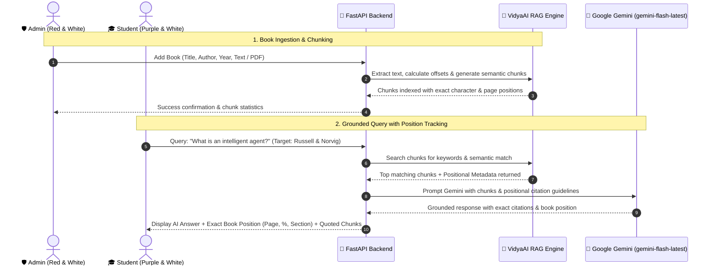

# 🏛️ VidyaAI — Smart Library Assistant with RAG & LLM

> **An advanced, dual-portal (Admin & Student) Intelligent Library System powered by Retrieval-Augmented Generation (RAG), Google Gemini LLM, Python FastAPI, and Svelte 5 + Vite.**

---

## 🎨 Theme System & Color Modes

The entire interface features dynamic **Dark Mode (🌙) and White Mode (☀️)** with a persistent 1-click toggle:

| Role Portal | Color Palette | White Mode (☀️) | Dark Mode (🌙) |
| :--- | :--- | :--- | :--- |
| **🎓 Student Hub** | **Purple & White** | Crisp alabaster white backgrounds, royal purple (`#7c3aed`) accents, dark violet headings | Deep midnight violet (`#0c0817`), neon purple highlights, crisp readable text |
| **🛡️ Admin Console** | **Red & White** | Crisp white backgrounds, bold ruby red (`#dc2626`) accents, dark burgundy headings | Deep crimson onyx (`#130709`), fiery ruby highlights, red borders & badges |

---

## 🌟 Key Features

1. **Dual-Role Entry Login**:
   - The application starts with an authentication page featuring 2 distinct portals:
     - 🛡️ **Admin Portal** (`admin` / `admin123`) — *Red & White Theme*
     - 🎓 **Student / User Portal** (`student` / `user123`) — *Purple & White Theme*
   - Includes **1-Click Demo Login** buttons so evaluators can switch accounts instantly.

2. **Admin Portal — Book Ingestion & RAG Chunking**:
   - Admin adds a book with **Title**, **Author**, **Publication Year**, and **Category**.
   - Accepts book content via **Direct Text Paste** or **Document Upload (.pdf / .txt / .md)** with automated text extraction.
   - **RAG Chunking Engine**: Automatically slices the document into overlapping semantic passages with exact positional telemetry (start/end character, page estimate, book percentage).
   - **RAG Chunks Inspector**: Admin can click *"View Chunks"* on any book to inspect the exact extracted passages.
   - **Gemini LLM Key Configuration**: Integrated with Google Gemini (`gemini-flash-latest`).

3. **Student / User Portal — Grounded RAG Book Search & Exact Position Tracking**:
   - Query across **All Library Books** or focus strictly on a **Specific Target Book**.
   - **Exact Position in Book**:
     - 📑 **Estimated Page**: Displays exact book page (e.g. `Page ~2 of 4`).
     - 📊 **Book Depth / Progress**: Shows progress into the book (e.g. `~24.5% into book`).
     - 🏷️ **Relative Section**: Highlights section (e.g. `Beginning Chapters (0-25%)`).
     - 🔢 **Chunk & Char Offset**: Displays chunk number and exact character span.
   - **LLM Grounded Answer**: Synthesizes a factual answer with verbatim quotes from the book.

---

## 🏗️ System Workflow



---

## ⚡ How to Run

### 1. Start Backend (FastAPI)
```bash
cd d:\library_assistant\backend
python run_server.py
```
*(Runs on `http://127.0.0.1:8000` — interactive API docs at `http://127.0.0.1:8000/docs`)*

### 2. Start Frontend (Svelte 5 + Vite)
```bash
cd d:\library_assistant\frontend
npm run dev -- --host --port 5173
```
*(Runs on `http://localhost:5173`)*

---

## 🔑 Login Credentials

| Role | Username | Password | Theme & Description |
| :--- | :--- | :--- | :--- |
| **🛡️ Admin** | `admin` | `admin123` | **Red & White**: Ingest books, view RAG chunks, manage catalog |
| **🎓 Student** | `student` | `user123` | **Purple & White**: Ask questions, view grounded quotes and exact book positions |

*(Both login options have 1-click quick-fill buttons directly on the login page)*
